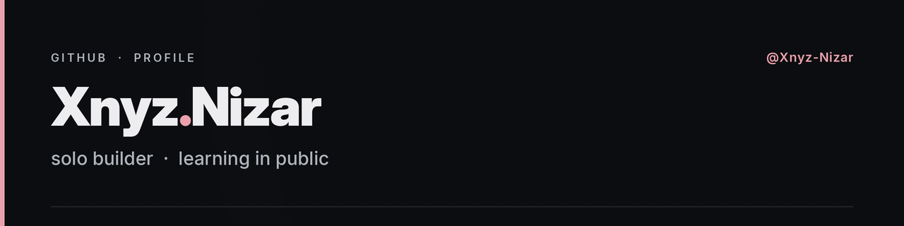

<div align="center">
  
</div>

<div align="center">
  <a href="https://github.com/Xnyz-Nizar"></a>
  <a href="https://x.com/Nizr_OG"></a>
</div>

<br/>

## A little about me

I build small things that work, instead of big things that don't.

Right now I'm learning in public — one project at a time, in the open, including the parts that break.

```ts
const me = {
  role: "solo builder",
  stack: ["TypeScript", "Node", "Python"],
  learning: ["shipping faster", "cutting scope", "reading other people's code"],
  rule: "if it doesn't run, it doesn't count",
};
```

## Now

- Building my first hackathon project
- Writing down what breaks, not just what works
- Keeping this profile honest — no badges I haven't earned

## Hackathons

_First one in progress._

<!-- After your first event, replace the line above with a table: Event, Project, Result. Only when true. -->

<div align="center">
  
</div>

<!--
STATS: enable after 2 or 3 public repos. Cards showing zeros look worse than no cards.
To enable, delete the two comment markers around the details block below.
-->
